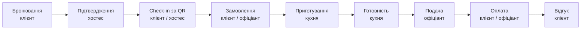
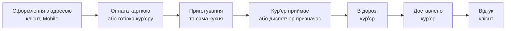

# 1. Аналіз предметної області

## 1.1 Проблема

Типовий візит до ресторану складається з кількох «вузьких місць», які забирають час і гостя, і персоналу:

| Етап | Що відбувається сьогодні | Наслідок |
|---|---|---|
| Бронювання | дзвінок у ресторан, запис у зошит / Excel | помилки, «подвійні» бронювання, неефективне використання столів |
| Прихід гостя | хостес шукає бронювання вручну | черга на вході, гість не знає свого столика |
| Замовлення | очікування офіціанта, усне замовлення | помилки, затримки в години пік |
| Кухня | паперові чеки, крик «на роздачу» | загублені позиції, немає контролю часу приготування |
| Статус | гість не знає, коли буде страва | нервування, повторні питання офіціанту |
| Оплата | очікування рахунку й термінала 10–15 хв | найгірший момент вечора, втрата оборотності столів |
| Доставка | сторонній агрегатор | комісія, немає контролю часу доставки й даних про клієнтів |

**Smart Restaurant** автоматизує повний бізнес-процес ресторану — від бронювання до оплати — і власну службу доставки, обʼєднуючи гостя, зал, кухню й курʼєрів в одну систему реального часу.

## 1.2 Користувачі та їх потреби

| Роль | Хто це | Потреби |
|---|---|---|
| **Клієнт** (гість) | відвідувач ресторану або клієнт доставки | швидко забронювати столик, бачити статус, замовити без очікування, знати коли готова страва, оплатити без рахунку; замовити доставку з передбачуваним часом |
| **Працівник залу** (хостес / офіціант) | персонал залу | бачити зал і бронювання в реальному часі, підтверджувати заявки, реєструвати гостей (check-in), приймати та подавати замовлення, фіксувати оплату |
| **Кухня** (кухар) | персонал кухні | чітка черга замовлень, таймери, відмітка готовності, стоп-лист |
| **Курʼєр** | працівник служби доставки | черга вільних замовлень, адреса й маршрут, дзвінок клієнту, сигнал «можна забирати», підсумки зміни |
| **Адміністратор** (технічна роль) | власник / керівник | керування меню, столами, QR-кодами, користувачами й ролями, зонами доставки, аналітика |

## 1.3 Бізнес-процес, що автоматизується

Процес доставки (Delivery API):

## 1.4 Аналоги

Порівняння за функціями, потрібними для повного циклу (дані — з офіційних сайтів і довідок сервісів):

| Функція | **OpenTable** | **Choice QR** (UA) | **Poster POS** (UA) | **Glovo** | **Smart Restaurant** |
|---|:---:|:---:|:---:|:---:|:---:|
| Онлайн-бронювання | ✅ | ✅ заявку підтверджує адміністратор | ⚠️ лише працівник у POS | ❌ | ✅ з автопідбором столика |
| QR-меню і check-in | ❌ | ⚠️ меню й замовлення за QR, без check-in | ⚠️ QR-меню (Poster QR) | ❌ | ✅ меню + check-in за бронюванням |
| Замовлення гостем зі смартфона | ❌ | ✅ за столиком і на доставку | ⚠️ через сторонні застосунки | ✅ | ✅ у залі (після check-in) і з доставкою |
| Kitchen display | ❌ | ❌ | ✅ Kitchen Kit | ❌ | ✅ спільний для залу й доставки |
| Статус замовлення в реальному часі | ❌ | ⚠️ для доставки (SMS, e-mail) | ❌ | ✅ | ✅ WebSocket + прогноз часу |
| Оплата зі смартфона | ⚠️ QR-код на чеку | ✅ | ❌ оплата на касі | ✅ | ✅ sandbox + 3-D Secure |
| Доставка і курʼєри | ❌ | ⚠️ сайт закладу, курʼєрські служби | ✅ застосунок Poster Courier | ⚠️ курʼєри Glovo, комісія | ✅ власні курʼєри, без посередника |
| Аналітика | ✅ | ⚠️ | ✅ | ⚠️ для партнера | ✅ зал і доставка разом |

**Висновки.** OpenTable сильний у бронюванні, але не має замовлення в залі, kitchen display і доставки. Choice QR дає QR-меню, замовлення й оплату зі смартфона, бронювання і сайт для доставки, проте бронювання підтверджують вручну без підбору столика, немає check-in за бронюванням і kitchen display. Poster — система для персоналу з kitchen display і застосунком курʼєра, але без гостьового застосунку. Glovo закриває доставку, але ресторан платить комісію, а курʼєри й дані клієнтів залишаються в агрегатора. Жоден аналог окремо не поєднує **повний цикл** «бронювання → check-in → замовлення → кухня → оплата» з власною доставкою в одній системі з єдиним застосунком для гостя. Це і є ніша Smart Restaurant.

Джерела: [opentable.com](https://www.opentable.com), [choiceqr.com](https://choiceqr.com), [joinposter.com](https://joinposter.com), [glovoapp.com](https://glovoapp.com).

## 1.5 Чим система відрізняється від CRUD

* **Booking engine** — алгоритм пошуку слотів і вибору оптимального столика з урахуванням буферів між гостями, годин роботи, зони та фрагментації розкладу; гарантія неперетину на рівні БД (EXCLUDE-обмеження PostgreSQL).
* **Скінченні автомати станів** бронювання, замовлення та доставки з перевіркою ролі, допустимості переходу й бізнес-умов (дедлайн скасування, вікно check-in, неоплачені замовлення тощо).
* **QR check-in** — QR-коди бронювань і столиків із випадковими токенами, перевірка «той самий столик», walk-in з автоматичним обмеженням часу візиту.
* **Sandbox-платіжний шлюз** — Luhn, строк дії, 3-D Secure, ідемпотентність, блокування рядка замовлення.
* **Real-time** — усі зміни миттєво потрапляють на Web, Mobile та кухню.
* **Рекомендації та прогноз ETA** — власні алгоритми (асоціативні правила, байєсівський рейтинг, модель черги кухні).
* **Служба доставки** — окрема система (Delivery API) на спільній базі даних: зони й тарифи, геолокація (формула гаверсинуса), курʼєри з обмеженням навантаження, події між системами через PostgreSQL LISTEN/NOTIFY.
